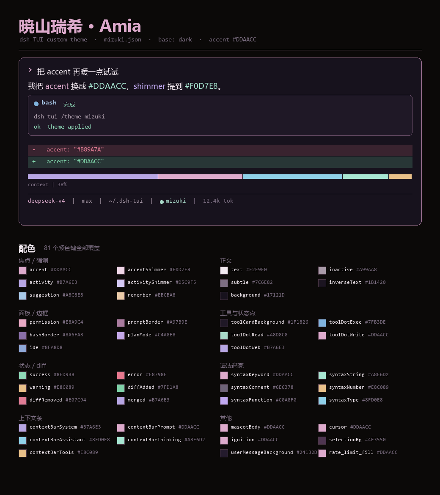
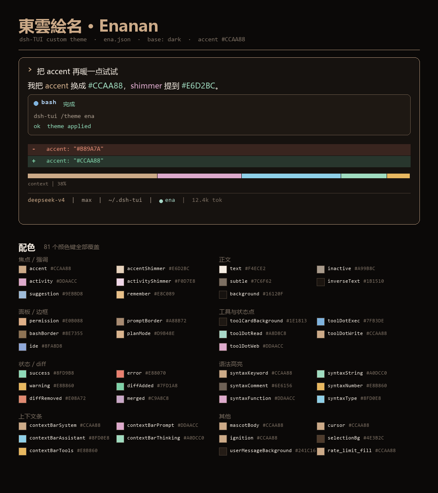

# dsh-tui · Project SEKAI 主题包

> A colour-theme pack + pixel-mascot pipeline for [dsh-tui](https://www.npmjs.com/package/@deepseek-harness-tui/dsh-tui), themed after *Project SEKAI* (Mizuki / Ena). 中文说明见下。

为 [dsh-tui](https://www.npmjs.com/package/@deepseek-harness-tui/dsh-tui) 做的两样东西，
围绕《世界计划 彩色舞台 feat. 初音未来》里的 **暁山瑞希**（Akiyama Mizuki）和
**東雲絵名**（Shinonome Ena）：

1. **两套主题** —— 各覆盖全部 81 个颜色键，用官方 image color 当 accent
   （瑞希 `#DDAACC`、絵名 `#CCAA88`），开屏大字走单色相色阶，不会串色。
2. **像素小人** —— 把官方 32×32 Q 版光标做成开屏 / 侧栏立绘，并给设置页加了一行
   「立绘形象」来选择显示哪个角色。

| mizuki | ena |
| :--: | :--: |
|  |  |

```
themes/mizuki.json      81 色键，base dark，accent #DDAACC
themes/ena.json         81 色键，base dark，accent #CCAA88
scripts/                把上面这些真正装上去的脚本
docs/PIPELINE.md        像素小人从哪来、怎么处理
docs/NOTES.md           走过的弯路（别再踩一遍）
```

## 三分钟上手

```bash
node scripts/setup.mjs mizuki      # 或 ena
```

一条命令搞定：拷主题 → 打两个补丁 → 如果 `assets/maid-<角色>/` 里已经有图就顺手装上 →
最后告诉你 `cordis.patch.yml` 还缺哪几行。重启 dsh-tui 就生效。

想只做其中一步也可以单独跑：

```bash
node scripts/install-themes.mjs mizuki        # 只装主题（会设为当前主题）
node scripts/patch-theme-colors.mjs           # 让 hex 主题的开屏大字跟着变
node scripts/patch-portrait-options.mjs       # 设置页加「立绘形象」那一行
node scripts/install-mascot.mjs mizuki   --normal assets/maid-mizuki/normal.png      # 只装立绘
```

立绘素材仓库里没有（版权原因），要自己生成：

```bash
python scripts/fetch-cursors.py Mizuki Ena
python scripts/cursor_head.py cursors/frames/Mizuki/Person/00.png assets/maid-mizuki/normal.png
python scripts/cursor_head.py cursors/frames/Ena/Person/00.png    assets/maid-ena/normal.png
```

没有立绘也能用主题，`setup.mjs` 会自己跳过那一步。

之后重启 dsh-tui（`terminalImages` 和这些补丁都在启动时读）。

## 为什么要打补丁

`dsh-tui` 自带主题的颜色都写成 `rgb(r,g,b)`，而自定义主题一般写 `#rrggbb`。
`lib/types/components/Spinner/spinnerUtils.js` 里的 `parseRGB()` 只认前者，遇到 hex
静默返回 `null` —— 结果就是**界面全都跟着主题变色，只有开屏那行大字还是品牌蓝**。
`patch-theme-colors.mjs` 让 `parseRGB` 认识 hex，并把大字重建成基于 `theme.accent`
的单色相色阶（`#DDAACC → #E8C5DC → #F2DFEC`），不再借 `activity` / `FLASH` / `PALE`。

设置页的行不是从配置文件读的，而是 `lib/types/dsh-adapter/plugin.js` 里一份显式字段
数组拼出来的，元数据来自 `lib/types/settings/definitions.js`，两边都不认识「立绘形象」。
`patch-portrait-options.mjs` 给它加一行：

```
开屏与吉祥物 → 立绘形象:  内置女仆娘 / 暁山瑞希 / 東雲絵名
```

两个脚本都是幂等的，**升级 dsh-tui 之后要重跑一次**（它们改的是
`~/.dsh/profiles/dsh-tui/node_modules/...` 里的文件）。

## 开屏立绘是三选一

来自 `lib/types/components/splashArtRows.js`：

```js
if (brand === 'deepseek' && (mascotSkin === 'deepy' || mascotSkin === 'whaleGirl')) return 'mascot';
if (input.whaleGirl || brand !== 'deepseek') return 'portrait';
return 'whale';
```

只要吉祥物皮肤是表情包（deepy / whaleGirl），`mascot` 就抢占这一格，立绘轮不到。
所以要让立绘显示，得这样配：

```yaml
# ~/.dsh/profiles/dsh-tui/cordis.patch.yml
terminalImages: true
whaleGirl: true
maidPortraitSkin: mizuki    # 由 patch-portrait-options.mjs 加出来
companion:
  skin: whale
```

`portrait` 走 kitty/sixel 真图，需要终端能应答图形协议（Windows Terminal 打开
`terminalImages` 就可用）。终端不支持时会退回 30×30 字符网格
（`whaleGirlSprite.js`）——同一个角色在不同终端里"糊"和"清楚"的区别来自这里。

## 版权

代码 MIT。角色像素图源自 *Project SEKAI COLORFUL STAGE!*（© SEGA / Colorful Palette），
**本仓库不包含这些图片**，脚本只在你本机下载或生成。详见 [NOTICE.md](NOTICE.md)，仅供
个人非商业使用。

---

## English

A colour-theme pack for `dsh-tui` built around two *Project SEKAI* characters:
two 81-key themes (`#DDAACC` / `#CCAA88` accents, single-hue title ramps), a
pipeline that turns the official 32x32 chibi cursors into splash/portrait art,
and two idempotent patches — `parseRGB()` learns hex (otherwise a hex theme
silently falls back to the brand blue wordmark), and a 「立绘形象」 row is added
to the settings panel so you can pick which character shows up.

Quick start:

```bash
node scripts/setup.mjs mizuki        # theme + patches (+ art when present)
python scripts/fetch-cursors.py Mizuki Ena
python scripts/cursor_head.py cursors/frames/Mizuki/Person/00.png assets/maid-mizuki/normal.png
```

Re-run both patch scripts after upgrading `dsh-tui`. Code is MIT; the artwork
belongs to SEGA / Colorful Palette and is not redistributed here.

> The docs above are the Chinese originals; they quote the code and error
> strings verbatim, so code stays as written.
